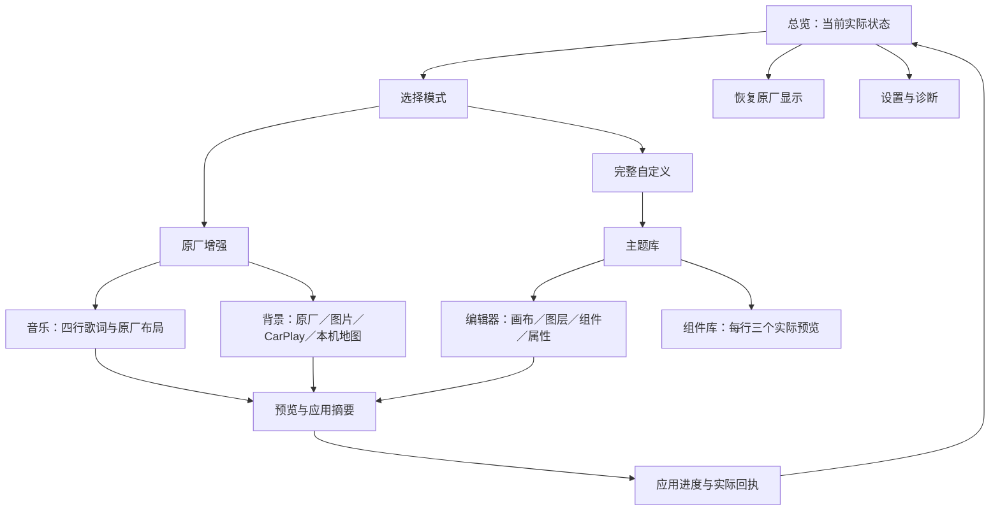
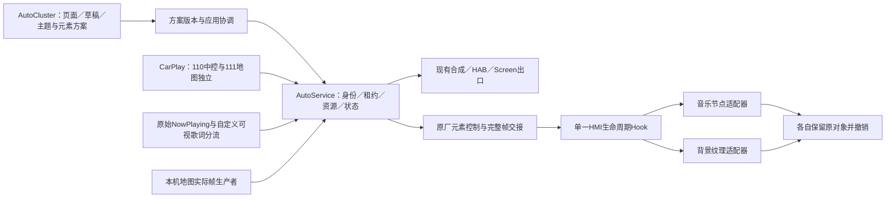

# Cluster 产品与全链路开发规划

日期：2026-11-11。状态：**待审规划 v0.1，尚未定稿，不作为继续修改业务代码的依据。**

目标：把已确认的“双模式、原厂元素可还原、四行歌词、图片与两类地图背景”做成可日常使用的独立 AutoCluster。先完成程序规划和页面设计，再由 WorkBuddy／hy4 编写确认后的界面候选，Codex 负责逻辑、原厂接入、集成及验证。

## 1. 已确认范围与本稿建议

### 已确认，设计时不再重新发问

- 保留现有直接运行遮罩和完整主题编辑器，新增原厂元素替换；不是用新模式取代旧能力。
- 原厂替换必须能还原原对象、属性及生命周期。背景、音乐等元素分别恢复。
- 原厂元素需求独立于 AutoService 旧仪表投屏开关，同时遵守 Root 等基础能力关闭选择。
- 背景支持本机地图、CarPlay 地图、本地图片，并能切回原厂背景。模式和背景分别保存。
- 歌词默认四行：上方一行已播放、第二行当前、下方两行待播放，进度条缩短。
- 原厂媒体继续使用 iPhone 原始 NowPlaying／动态歌词；完整网络歌词仅用于有实际需求的自定义可视呈现。
- 中控继续继承项目 FlymeAuto 风格；L6／L7 共用竖屏 UI，L6 2023 Max、FlymeAuto 2.3.1 优先验收。
- 现有 GT 表、巡航三态与差值弧、四档回收、胎压／能耗分页、独立挡位及驾驶模式等能力保留。不能把它们全部搬进本轮原厂音乐卡片。

依据：[双模式研究](Cluster双模式与原厂多行歌词研究-20261111.md:3)、[模式边界](Cluster双模式与原厂多行歌词研究-20261111.md:43)、[二轮需求](Cluster二轮需求-巡航回收与音乐分区-20261030.md)、[视觉校正](Cluster样式校正与原厂素材-20261030.md)及根 AGENTS.md。

### 本稿提出、需要随设计评审的产品选择

| 选择 | 建议 | 理由与可比较依据 |
| --- | --- | --- |
| 用户看到的模式名 | “完整自定义／原厂增强”，技术文档继续写遮罩／元素替换 | 用户能直接理解显示效果；原名称保留为说明，避免混淆两条出口 |
| App 导航 | 四个一级入口：总览、原厂增强、主题、设置 | 把日常启停、原厂配置、完整主题制作、基础设置分开；具体布局交 UI 设计 |
| 编辑与应用 | 保存草稿、预览、应用分离 | 编辑时不改仪表；应用必须有实际端回执，保存成功不能显示为已运行 |
| 模式切换 | 单一活动输出，先完成旧输出撤销，再提交新输出 | 避免遮罩覆盖原厂增强；切换失败显示实际状态，不暗换成另一条路线 |
| 原厂入口 | 音乐／背景逐项启停，加“恢复原厂显示” | 一键恢复能明确撤销自有修改；不能把按钮变成关闭 Root／ADB |
| 首次使用 | 明确选择模式后应用；旧安装保留已存模式和已应用主题 | 不擅自替换老用户正在运行的方案 |

导航还有一个可选方案：保留“我的主题／编辑主题／组件库”三 Tab，顶部另加模式与设置入口。它改动较少，但日常原厂配置与主题制作混在同一层。比较的是 **4 个任务入口**与**3 个主题入口加独立入口**，不是性能差异。推荐四入口；现有三个主题功能下沉到“主题”内部，功能不删。

## 2. 页面与信息架构

中控是配置和制作界面，仪表是最终呈现界面。设计交付要同时展示两者，不允许只有中控漂亮卡片、没有实际仪表效果图。

### 页面规格

| ID／页面 | 必须出现的内容 | 操作及结果 |
| --- | --- | --- |
| P01 总览 | 当前模式、方案名称、比例正确的仪表缩略图、运行／停止／等待来源／异常状态、待应用标记 | 启用／停止；进入对应编辑；恢复原厂；不把“服务已绑定”写成“仪表已显示” |
| P02 模式选择 | 两种模式的真实效果对照、各自改变哪些区域、当前模式 | 选择仅生成草稿；继续进入配置；离开未应用不触发远端切换 |
| P03 原厂增强总页 | 1920×532 仪表示意与可修改区域标记、音乐和背景的独立摘要、原厂保留区域 | 进入元素页；单项恢复；应用；元素状态逐项列出 |
| P04 原厂音乐 | 歌名／歌手、四行歌词、短进度、原厂封面保留区域、字体与间距分组 | 调整有 ABI／布局支持的属性；预览换歌／seek；恢复音乐原样；不开放任意拖动原厂安全图标 |
| P05 背景来源 | 原厂、本地图片、CarPlay 地图、本机地图四类；当前选择和实际来源状态 | 选择来源；进入参数；无源时明确等待，不自动换成其他来源 |
| P06 图片与取景 | 已导入图片、1920∶532 取景框、完整保留／用户主动裁切、日夜预览 | 系统文件选择；取景；确认／取消；不强制拉伸、不默认裁掉内容 |
| P07 地图显示 | 本机／CarPlay 来源分别标识、完整画面、边缘虚化／范围／圆角等既有参数 | 预览参数；显示未连接或等待首帧；CarPlay 标清 111 来源，不能拿示意路网当真实导航 |
| P08 主题库 | 内置／自定义、当前已应用版本、草稿、预览图、名称 | 新建、编辑、另存、导入、导出、重命名、删除；内置主题不原位覆盖 |
| P09 主题编辑器 | 固定比例画布、选择／多选、图层、撤销／重做、日夜、属性面板 | 复用现有组件树；保存／应用分离；修改草稿不影响当前输出 |
| P10 组件库与详情 | 每行三个实际样式预览；日夜、数据来源、适用模式说明 | 只浏览；添加只在编辑器；原厂节点不伪装成可任意放置组件 |
| P11 预览与应用摘要 | 当前到目标的模式／元素／背景差异、日夜效果、来源状态 | 应用／返回修改；演示数据显著标识“预览”，不发布到正式链路 |
| P12 应用与恢复 | 准备／提交／等待显示／完成，以及每项结果 | 仅目标端回执后显示成功；失败可查看原因；恢复过程不只弹一个 Toast |
| P13 显示设置 | 跟随／日／夜、刷新策略与上限、启动行为、保留上次方案的说明 | 默认沿旧安装实际配置；FPS 是上限不是承诺；ADB／Root 设置只提供 AutoService 状态与跳转 |
| P14 诊断 | App／合同版本、连接阶段、原厂 Hook／元素状态、来源新鲜度、最近错误 | 详细技术信息放此页；日常页面不堆 Shell／PID／ABI 地址；不加入任意车辆控制 |

图标复用本项目现有资源。原厂图标／状态样式按本车材料对照，未取得的素材登记缺口，不凭近似图宣称还原。

### 必须设计的关键状态

- 已停止、旧方案运行、草稿未应用、准备中、等待来源、运行中、恢复中、恢复完成、失败。
- AutoService 断线；Root 被用户关闭；iPhone 未连接；本机地图无帧；图片删除／不可读。
- 有完整时间轴歌词、只有手机当前句、无歌词、暂停、拖动进度、切歌、曲首／曲尾、长标题／长中文句。
- 日间与夜间；页面退出后后台持续；切换模式；应用过程中再次操作；旧回执迟到。
- “全部恢复”有未保存草稿时的去向；恢复音乐后背景仍保持、恢复背景后音乐仍保持。

### 视觉交付要求

以 CarPlay／AutoService 已生效的 Flyme 设置色阶、文字角色、设置行、细圆角和触控尺度为依据，不把仪表内容区做成中控设置页。现有 ClusterUi 的日夜色板在 [ClusterUi.kt:13](../galaxy/cluster/src/main/java/com/galaxy/autocluster/ui/ClusterUi.kt:13)；设置区色阶参考 [Flyme 基线 §2](AutoRecord/FlymeAuto样式基线-20261103.md)。这些是参考来源，不把 AutoRecord 专属导航宽度或旧稿中的默认值当成 Cluster 已确认尺寸。

设计师先从工程已有目标车截图／配置核对中控物理画布，注明 px、dp、density；本稿不猜分辨率。仪表目标画布为 1920×532。四行原厂音乐当前约 280px 宽、140px 高，是已有候选边界，必须结合原厂区域设计，不能直接套遮罩模式约 324px 的旧音乐卡片。

## 3. 端到端架构

以下是拟议职责及接口语义，名称可在技术设计中调整；不登记为已经可用的 API。

| 所有者 | 负责 | 复用／改动边界 |
| --- | --- | --- |
| AutoCluster | 草稿、活动方案、模式、背景、可视属性、编辑预览、应用请求与状态显示 | 保留 ThemeStore／EditorSession／SceneRenderer；新增元素方案模型和统一应用协调。中控 Activity 不持有最终运行生命周期 |
| AutoService | 客户端鉴权、按需租约、Root／QNX 准备、部署与版本摘要、资源分配、运行回执 | 不让每个 App 自建 Root／QNX 登录；旧遮罩需求与原厂元素需求分开；基础能力关闭选择统一生效 |
| CarPlay | iPhone 连接、110／111 视频、原始媒体及自定义歌词生产 | 原厂原始媒体出口保留；完整歌词按需求查询并单独标来源；不承载整个主题编辑器 |
| 本机地图适配器 | 定位本车实际地图帧生产合同、取得帧并随需求释放 | 先完成本车源码／固件追踪；不能用 EmptyDimAdapter 或结构化 TBT 代替完整地图帧 |
| QNX 帧接收层 | 帧验证、共享槽位、完整帧发布、消费确认 | 从现有 Screen 消费路径抽出消费接口；保留旧窗口出口，新增 Kanzi 消费者；不重写第二套认证协议 |
| HMI Hook 宿主 | 一个 UI 生命周期入口，协调音乐和背景，每个元素报告提交／撤销结果 | 不让多个 SO 独自覆盖同一虚槽；节点访问与纹理提交放原厂 UI 线程 |
| 元素适配器 | 原对象强引用、可见树匹配、提交、刷新、撤销 | 音乐复用节点还原层；背景新增真实 Texture 所有权／原属性恢复，不能把重启 HMI 当作每次切图的日常实现 |

### 配置、需求、实际状态分开

1. **用户配置**：选什么模式、启用哪些元素、背景来源与资源、日夜及外观。长期保存。
2. **运行需求**：当前活动方案及实际消费者需要哪些音乐／地图／车辆键。绑定 owner、generation；死亡、关闭、切换后撤销。
3. **实际状态**：端版本、来源是否可用、原厂实例与场景代次、哪些元素真正提交／恢复、错误原因。来自目标端回执，不能从配置推断。

推荐合同至少包含 `schema / ownerGeneration / planRevision / mode / elements / background`；媒体包含稳定 `trackId / source / session / revision / sampledAt / position / playing / lyricTimes / lyricLines`；帧包含 `session / sequence / width / height / stride / format / source / releaseAck`。字段上限与版本兼容在技术设计落实，原始文本不拼入 Shell。

### 歌词两条语义链

- 原厂媒体链：iPhone 原始 NowPlaying／当前句 → 已有 EAS／DIM／原厂通路。不能被网络歌词或固定歌名覆盖。
- 自定义可视链：实际遮罩／原厂音乐替换需求 → 已有查询与有界缓存 → 带来源、曲目身份和时轴的可视快照 → 两种渲染适配器。
- 四行都按同一条时间轴定位，当前句固定第二行；切歌清旧代、seek 立即重定位；仅当前句时如实显示，不编造上下句。
- 固定容量／TTL、成功结果缓存、撤销需求停止查询、迟到结果拒收继续沿既有约束。不能因 App 页面打开就查网络歌词。

已有入口：[按需歌词](../galaxy/common/src/main/java/com/shilapi/xcertplay/GalaxyClusterMusicBinding.kt:135)、[四行提取](../galaxy/common/src/main/java/com/shilapi/xcertplay/GalaxyKanziMusicFrame.kt:14)、[原对象恢复](../galaxy/common/src/main/cpp/kanzi_music/node_replacement.h:15)。

### 背景完整帧链

- 图片：系统选图 → 私有有界资源 → 解码／日夜资源准备 → 完整帧或纹理资源 → 活动背景绑定 → 撤销时恢复原纹理及原属性来源。
- CarPlay：iPhone 111 → 独立解码 Surface → AutoService 地图资源 → HAB 完整帧 → QNX 最近完整帧邮箱 → HMI UI 线程 Texture 更新。中控 110 的 Surface／尺寸不受此路径改写。
- 本机地图：本车真实 Surface／服务合同 → 同一背景帧消费合同；先追闭生产者，不把其他车型屏号和服务参数搬入 L6。
- 原厂：撤销背景适配器的覆盖并恢复原对象；无新背景需求时不继续取地图帧。

原厂背景在遮罩模式下的呈现关系要在设计和渲染接点评审中明确：不能把“恢复原厂纹理”误显示为“完整自定义主题仍可看穿全部原厂内容”。同一来源保留配置，两条出口的可视范围分别说明。

## 4. 生命周期、切换和还原

拟议状态：`停止 → 准备 → 提交 → 等待端回执 → 运行 → 撤销 → 已恢复`，失败保留阶段及具体原因。

- 模式切换：保存目标草稿 → 准备目标资源 → 撤销旧输出并收到回执 → 提交目标 → 收到显示回执后更新活动状态。等待期间不接受旧代回执。
- 修改单个元素：按 revision 准备 → UI 线程提交 → 单项回执；音乐和背景分别有所有权与恢复记录。
- 停止／全部恢复：先使旧租约失效 → 取消数据与图像生产 → 原厂元素撤销或自有窗口关闭 → 汇总真实恢复状态。
- 原厂场景更换：撤销旧树引用 → 识别新树代次和唯一有效节点 → 按当前方案重挂；迟到帧不写旧 Texture。
- 断链／进程异常：租约到期与既有独立恢复机制分别验证；不把“超时到了”当作恢复成功。
- 用户主动关闭：持久选择优先，后台恢复任务和客户端重连不能重新启用。

正常节点／纹理恢复与异常 HMI 进程恢复是不同层。现有约 9 秒进程内探针及 20 秒看门狗只是限时研究事实；日常租期、续租、异常恢复机制需要专门技术设计，不能原样拿来当产品长期运行能力。

## 5. 已有证据与真实缺口

| 链路 | 已有证据 | 仍要完成／验收 |
| --- | --- | --- |
| 遮罩与主题 | 已有主题编辑、运行服务、地图合成、HAB／Screen 源码及既有离线流程 | 重构前后旧包／主题兼容、独立预览、稳定连接、实车性能与原车告警分别回归 |
| 四行音乐 | 真实节点坐标、140px 候选、原对象恢复与宿主测试 | 新布局实屏、中文／长句／日夜、实际完整歌词接入、稳定媒体身份 |
| 背景图片 | 固定 Dark_BG1 资源替换与恢复已有实屏记录 | 任意用户图片、纹理实时绑定／切换、日夜、持续运行与原属性还原 |
| Kanzi 纹理 | 部分 Texture／Image2D 符号地址已定位 | CreateInfo、GraphicsFormat、stride／通道、持有和释放、UI 提交时机逐项核对 |
| CarPlay 背景 | 111 独立 Surface、现有地图合成及传输源码 | 元素模式独立需求、完整帧交接、纹理消费、真实 111 车道级内容单独验收 |
| 本机地图 | 本车地图／DIM 材料与追踪记录 | 实际帧生产者与服务合同尚未闭合；继续研究，不以假帧或禁用替代交付 |
| 原厂 SR | 本车节点与 Hook 研究；P 挡有效可见条件有记录 | 当前 P 挡未验 SR 显隐；不把隐藏 ADAS 根节点放进日常一键背景动作；单列设计与验收范围 |
| App 产品化 | 既有 Cluster 页面／编辑器 | 新的信息架构、设计稿、状态合同、独立元素运行与长期恢复；上一轮未审代码不能计入完成 |

来源：[双模式研究:35](Cluster双模式与原厂多行歌词研究-20261111.md:35)、[背景缺口:54](Cluster双模式与原厂多行歌词研究-20261111.md:54)、[纹理与消费:60](Cluster双模式与原厂多行歌词研究-20261111.md:60)、[本机地图追踪:80](L6原厂仪表局部地图接入追踪-20261103.md:80)、[独立 Hook 实测](L6原厂仪表独立Hook实车验证-20261111.md)。

## 6. 分工、交付顺序与验收

| 阶段 | 负责人 | 必须交付 | 通过条件 |
| --- | --- | --- | --- |
| G0 产品规划 | Codex | 本文、页面清单、方案比较、来源与缺口、设计任务书 | 用户能明确评审导航、模式命名、应用／恢复流程和范围；不要求用户决定源码可查的技术细节 |
| G1 UI／移动设计 | WorkBuddy／hy4，Codex核对约束 | 两种导航结构的关键页对照；推荐方向的全页面日夜静态稿、关键状态、仪表效果、交互标注 | 先审视觉和流程，再冻结设计版本；仅设计目录写入，无 Android 界面代码 |
| G2 技术设计 | Codex | 配置／状态／租约合同、模块和线程所有权、切换序列、Texture ABI证据、接口任务拆分 | 合同明确，未知 ABI 与生产者接点有定位工作包；不能用提前写的类反过来决定产品 |
| G3 界面候选与逻辑实现 | WorkBuddy做确认后的UI候选；Codex做链路 | 可审 UI 候选、正式逻辑、契约与生命周期测试；按“恢复→音乐→图片→地图”纵向集成 | 每条都能从页面操作到实际端状态再到恢复；界面演示成功不等于车辆端成功 |
| G4 离线集成 | Codex | 单命令回归、三 APK 同批摘要、原生恢复测试、旧主题兼容记录 | 无 Lint、无模拟器；失败真实记录；构建通过与实屏验收分开 |
| G5 驻车实车 | Codex，在适用的明确授权内 | 分项实屏／源帧证据、节点恢复／进程恢复、性能前后对比 | 音乐、图片、两类地图分别验收；不把历史驻车授权扩大为新的 HMI 长期部署 |

G1 和 G2 可以在规划方向明确后并行研究，但 **G3 的业务／界面编码必须在对应规划及视觉稿确认后开始**。不把设计任务交出去就当作设计已完成。

### 技术集成工作包

1. 应用协调与恢复：单活动出口、每项回执、旧代拒收、全局关闭和恢复持久状态。
2. 音乐纵向链：原始／可视分流、完整歌词需求、四行时间轴、Kanzi 挂接和原对象还原。
3. 图片纵向链：资源导入、日夜／取景、Texture ABI、绑定与撤销。
4. 帧消费共用层：传输和显示消费者分离、完整帧邮箱、消费确认、UI线程所有权。
5. CarPlay 地图：111 独立请求、Surface 重建与尺寸、完整内容与车道级实帧。
6. 本机地图：生产者追踪 → 帧合同 → 接入共用层 → 单独实车验收。
7. 旧模式回归：主题／图库／导入导出／车辆订阅／地图／音乐／方控／退出全部保留。

本机地图生产者和 Texture ABI 是优先研究项，不能等 UI 完成后才发现缺口；也不能在研究未闭合时先写假成功的适配器。

### 验收证据与资源预算

- 每批绑定源码摘要、APK／SO摘要、配置revision、来源、实际端回执、截图及恢复回执。
- 测例覆盖：旧安装、冷启动、重新连接、模式来回切换、保存不应用、取消选图、连续切歌／seek、无歌词、长句、无源、重复停止、场景换根和异常恢复。
- 性能记录 CPU、PSS、线程、FD、采集／传输／呈现延迟、实际 FPS，区分静态／音乐／地图以及原厂基线；本稿不声称任何实测提升。
- **算术估算**：假设输出为 1920×532、4 bytes/pixel，一帧为 4,085,760 bytes（约 3.90 MiB），30fps 单次全帧搬运约 116.90 MiB/s，60fps 约 233.79 MiB/s；双缓冲约 7.79 MiB。实际输入尺寸、额外复制、Texture分配与显存开销另测。这是避免盲目多份帧复制的依据，不是“零拷贝”证明。
- 队列只保留最近完整帧；生产者不得在消费者释放前覆写槽位。帧是否消费完成与是否真正显示分开记录。

## 7. 当前工作树与本轮边界

此前在规划／设计前提前修改的业务候选全部冻结，不提交、不装车、不作为已审接口，不据其继续实现。原先已有的四行原生节点与恢复研究成果保持原样。

提前修改涉及：AutoClient、ClusterActivity、ClusterRenderService、GalaxyAutoServiceBinding、IAutoService、AutoContract、AutoService、ClientRegistry 及其测试；新建 ClusterDisplayConfiguration、ClusterDisplayStore 及配置测试。规划确认后逐项审查去留，禁止全树 reset／clean／stash 覆盖其他未提交成果。

上一轮全工程离线构建因依赖缓存缺失等问题失败，尚无该批验证通过结果。本轮只新增规划和设计交接文档，没有新增业务修改、构建、模拟器、车辆连接或安装。

设计任务书：[WorkBuddy Cluster UI 与移动设计任务书](Cluster-WorkBuddy界面设计任务书-20261111.md)。
