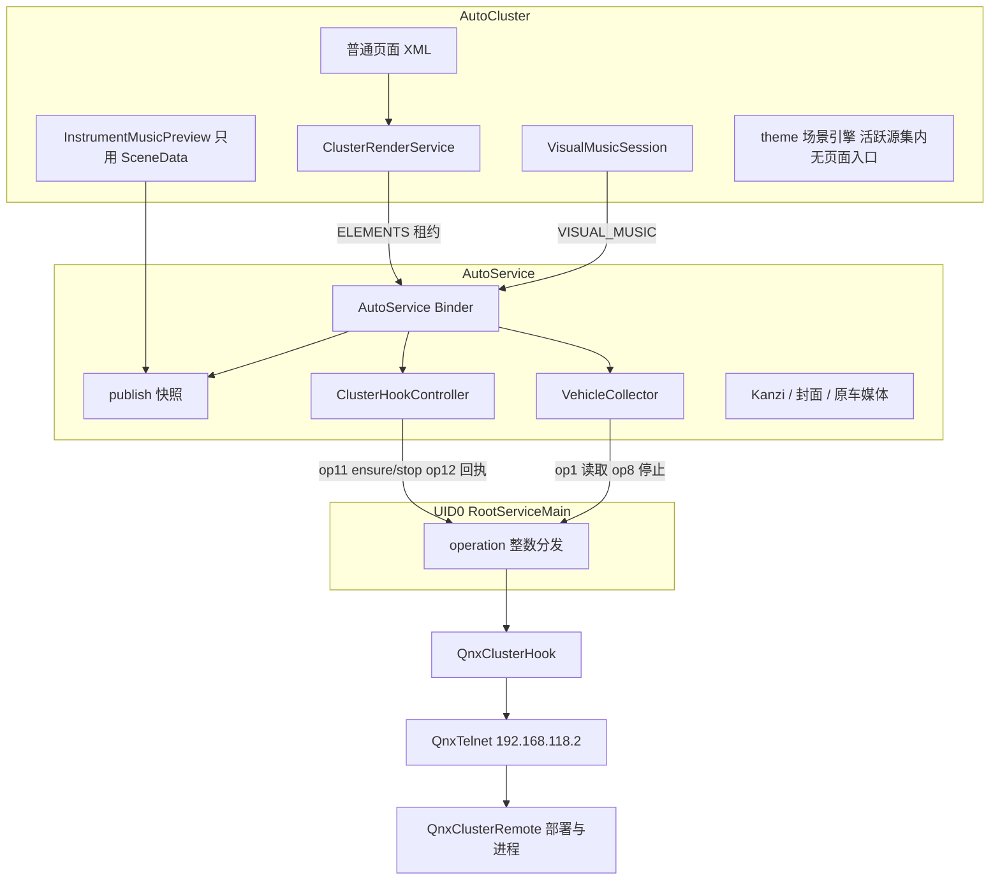

# service / cluster 包、架构与代码加强规划

> 2026-11-12 Windows 首轮核对后，执行状态以 [Cursor协同总控](Cursor协同总控-20261112.md) 和 [首轮审计与修正任务](Cursor首轮审计与修正任务-20261112.md) 为准。下文保留此前规划与来源事实。两个候选分支已经实现部分移动，但未验收；当前首先处理验证环境与 R0，不能把规划中的包表视为已完成，也不能把“假协议已调整”视为四例已经实际通过。

2026-11-12。当前工作分支是 `feat/galaxy-android-r0-20261112`（`9464d08`）。对照文档分支 `feat/autoservice-optimization-handoff-20261110` 只少了 R0 实现提交 `b704820`，规范与 U1/C1/C2a 历史两边都有。本文在 GPT 已落地的 XML/页面拆分和整屏归档之上，补它没有做完的包归属、类位置和平台注入。

编码以[项目规范](service-cluster项目规范-20261112.md)和[代码规范](service-cluster代码规范-20261112.md)为准。本文只保留批次顺序和现状，不另给一套写法。尚未把实现合并进本分支。

## 1. GPT 已经做成的，以及还缺的

已经在这个分支上、并且应保留的：

- 普通页面走 XML + View Binding。Service 首页/诊断、Cluster 首页/原厂/音乐/背景/设置已按页拆开。见 [重构总图](重构总图-20261111.md) 的 U1、C1、C2a。
- 旧整屏覆盖投屏的专用运行代码已移到 `archive/legacy-fullscreen-projection/20261112/`，不进 Gradle 源集。AutoService 对 `THEME`/`PREVIEW` 只回报 `projection_archived`。见 [R0 交付](handoff/R0-20261112/DELIVERY.md)。
- 原厂音乐卡片、背景元素、Hook、车辆订阅、基础 ADB/Root、CarPlay 的 MAP 数据仍在产品范围内。

没有做成、也是这次要补的：

- 拆类基本停在 UI。`AutoService.kt` 仍有 1593 行，同时持有 Binder、快照、车辆订阅扇出、媒体/封面、原厂元素、远程和网页桥。
- `platform/` 有 34 个类，把 ADB、Root 套接字、QNX Telnet、原厂 Hook、权限修复、POSIX 校验和归档拒绝器放在同一包。调用方直接传 operation 整数。
- Cluster 的 `theme/` 仍有 35 个生产 Kotlin 文件留在活跃源集。整屏编辑器 UI 已经归档，但这套场景引擎还在 APK 里。活跃源集里，包外只有音乐卡片预览在用 `SceneData`。
- R0 门槛仍是 `BLOCKED_VALIDATION`：`ClusterHookLifecycleTest` 3 例失败。失败文件本批零改动，测试假协议和现行 `QnxClusterRemote` 的 token 对不上。这是验证残留，不是包结构问题。

下一功能队列不再按总图直接派 A1 账号页。A1 仍是账号页 XML 拆分，和 service/cluster 的内部结构无关，放到本规划的结构批次之后。

## 2. 现在的运行结构

两个应用仍然各是一个 Gradle 模块，不拆新模块，不改 `applicationId`、签名、AIDL 版本和 prefs 键。

原厂 Hook 的真实注入点不在 UI，而在 Root 进程：

| operation | 现有入口 | 调用方 | 帧 |
| --- | --- | --- | --- |
| 0 | 回 `root_ready` | `RootServiceClient.healthy` | 无 JSON |
| 1 | 车辆订阅周期 | `RootServiceClient.read` | 定长 JSON，复用连接 |
| 2 | 退出 helper | `RootServiceClient.stop` | 无 JSON，回 int 0 |
| 3 | `ShellExecutor` | `PlatformAccess`、`AppPermissionSetup` | 定长 JSON |
| 4、6 | `RootProjectionArchive.rejectIfArchived` | 无新调用方 | 消费后关闭 |
| 5 | `QnxReceiverCleanup.stop` | 显式清理 | 定长 JSON |
| 7 | `AdbKeyAuthorization` | `PlatformAccess`、`AdbConnection` | 定长 JSON |
| 8 | 停车辆源 | `VehicleCollector` | 无 JSON |
| 9 | 哨兵控制 | `SentinelCoordinator` | 定长 JSON |
| 10 | 哨兵流 | Root 进程内直接 `stream` | 非 JSON 回复 |
| 11 | `QnxClusterHook.control` | `ClusterHookController` 的 ensure/stop | 定长 JSON |
| 12 | `QnxClusterHook.receipt` | `ClusterHookController` | 无 JSON |

`PlatformCoordinator` 只恢复 ADB/Root 身份和权限，不再准备投屏。Hook、车辆、媒体各自在身份就绪后使用这条通道。这个边界是对的，要保留。不合理的是身份恢复、传输、Hook 策略和远程进程生命周期都堆在 `platform` 这一个包，而且 operation 数字散落在调用点。

Cluster 侧，文件系统核对结果：

- `ClusterSceneOutput`、`ThemeActivity`、编辑器页面只在归档目录。
- 活跃源集里 `ScenePreparation` 没有调用者。它原先只被已归档的 `ClusterSceneOutput` 使用。
- `InstrumentMusicPreview` 和 `DemoContent` 只依赖 `theme.SceneData`。`SceneData` 把快照 Bundle 转成媒体/车辆读数，供 320×316 卡片预览，不编译主题包。
- `theme/` 其余生产类（`EditorSession`、`ThemeStore`、`SceneRenderer`、各 Painter、`SceneXml` 等）和 9 个主题测试仍编进活跃源集，但没有剩余页面入口。

## 3. 目标架构

保持「一个 AutoService 进程拥有平台身份和原厂注入，一个 AutoCluster 进程只表达显示意图和本地预览」。不引入 DI 框架、事件总线或新的 MVVM 依赖。类的拆分按现在已经存在的调用链走，不另造抽象层。

AutoService 进程内四块：

1. **装配。** `AutoService` 只做前台服务生命周期、创建 worker、把各 owner 接上、销毁时按现有顺序释放。
2. **契约入口。** Binder 只鉴权、校验角色、排队。`THEME`/`PREVIEW` 继续在入口拒绝。快照组装单独成发布者，不在 Binder 里拼 Bundle。
3. **业务 owner。** 车辆、媒体、原厂元素、远程、哨兵、网页桥各自持有自己的状态、线程和释放。它们可以读快照所需字段，不互相启动对方。
4. **平台端口。** App 侧只通过具名端口访问 Root。Root 进程只认证、读帧、按表分发。Hook 的租约判断、材料组装、Telnet 会话、远端进程四步分开，仍由 op11/op12 串起来。

AutoCluster 进程内三块：

1. **页面。** 现有 `ui/pages` 与 `ClusterActivity` 继续只做导航和呈现。
2. **原厂运行时。** `ClusterRenderService` 只在已提交的 `OEM_ELEMENTS` 上连接 ELEMENTS，并持有 `VisualMusicSession`。
3. **卡片预览模型。** `SceneData` 从主题引擎里拆出来，归音乐卡片。主题场景引擎是否继续打进 APK，见第 6 节待确认项。

## 4. 包规划

包名根不动：`com.ecarx.autoservice`、`com.galaxy.autocluster`。下面是目标位置，不是本轮已经发生的移动。

### 4.1 AutoService

| 目标包 | 放什么 | 现在在哪 |
| --- | --- | --- |
| 根 | `AutoService`、`ServiceActivity`、`DiagnosticActivity`、`SerialWorker`、`ServiceTrace` | 已在根；`AutoService` 瘦身后留下 |
| `ipc` | Binder 实现、`ClientRegistry`、快照发布 | Binder 在 `AutoService` 内部；`ClientRegistry` 在根 |
| `vehicle` | 现有采集、目录、订阅 | 已成形，feed 扇出方法从 `AutoService` 移入 |
| `media` | `KanziMediaPublisher`、`KanziMediaFrame`、`OemArtworkWriter`、`ArtworkProvider`、`NativeMediaSource`、封面接收 | 后四者在根，`NativeMediaSource` 已在 `media` |
| `oem` | `ClusterHookController`、`ClusterHookReceipt`、背景图存储与 PNG、元素图片配置、`input/ClusterMenuInput` | Hook 与背景在根 |
| `platform.foundation` | `PlatformCoordinator`、`PlatformAccess`、`FoundationRecovery`、权限修复 | 都在 `platform` |
| `platform.adb` | `AdbConnection` 至 `AdbTypes`、`WirelessAdbStartupActivator` | 都在 `platform` |
| `platform.root` | `RootServiceMain`、`RootServiceClient`、`RootWire`、`RootOwner`、认证、`ShellExecutor`、`RootProjectionArchive` | 都在 `platform` |
| `platform.qnx` | `QnxTelnet`、`QnxCredentials`、`QnxOemCredentials`、`QnxReceiverCleanup` | 都在 `platform` |
| `platform.hook` | `QnxClusterHook` 拆开的租约/材料、`QnxClusterRemote`、`KzbBackgroundPatch`、`PosixChecksum` | 都在 `platform` |
| `remote` `sentinel` `startup` `settings` `ui` `diagnostics` `web` | 维持现有边界 | 已有包；远程开关仍由 `AutoService.updateRemote` 装配 |

`oem` 只表示原厂元素增强。归档后的整屏投屏不放进这个包，拒绝器留在 `platform.root`。

### 4.2 AutoCluster

| 目标包 | 放什么 | 现在在哪 |
| --- | --- | --- |
| 根 | `ClusterActivity`、`ClusterRenderService` | 已在根 |
| `ui` / `ui.pages` / `ui.navigation` | 现有页面、Presenter、动作 | 已拆开，保持 |
| `runtime` | `ClusterDisplayStore`、`ClusterDisplayStatus`、`ClusterAppearance`、`VisualMusicSession` | 已在；`ScenePreparation` 不属于这里 |
| `preview` | `SceneData`、`SceneMedia`、`SceneSignal`、`InstrumentMusicPreview`、`DemoContent` | `SceneData` 现在在 `theme`，预览在 `ui` |
| `theme` | 批次 3 起不再留在活跃源集；引擎进归档 | 35 个文件目前仍在活跃 `theme` |

`BackgroundImagePicker` 继续服务原厂背景页，留在页面/运行时侧，不随主题引擎归档。

## 5. 代码批次

每批只搬已经核对过的方法和调用，不改协议字节、超时、重试次数、角色校验和释放顺序。一批一个提交。上一批门槛没过，不开始下一批。

### 批次 0：先收口 R0 验证

这不是结构重构。生产 `QnxClusterHook.kt` 不改。`ClusterHookLifecycleTest` 的假执行器已按现行 `QnxClusterRemote` 令牌改写，四条例仍分别证明：已安装且健康则复用、不重启；首次先部署、再校验、后激活；部署后租约取消抛 `cluster_lease_inactive` 且不激活；材料已安装但 inspect 报 `firmware_mismatch` 时不激活。

`scripts/verify_projection_retirement.sh`、`verify_format.py`、`verify_artifacts.py` 和 `format_check.py` 不再写死 `/Users/anjon/Documents/GalaxyPlay/.work`。未设置时缓存和报告都用当前仓库 `.work`；`GALAXY_REFACTOR_CACHE`、`GALAXY_KTLINT_JAR`、`GALAXY_R0_REPORT_DIR`、`GALAXY_XMLLINT` 可显式覆盖。ktlint 仍必须是 1.4.1，摘要不变。

本机没有 `.work` 里的 Android SDK 和 ktlint jar，也没有 `ANDROID_HOME`。单命令门槛没有跑，状态仍是 `BLOCKED_VALIDATION`。缓存补齐后才能把这批测试写成通过。Mac 上的环境还在传来；验证继续等这些资料。

2026-11-12 晚，用户允许在等资料时用分会话先做不依赖缓存的实现。Leader 留在 `feat/galaxy-android-r0-20261112` 做审计，不把未审改动直接写进该分支。两个隔离工作树从 `92cf470` 拉出，写范围不重叠：

- `feat/galaxy-platform-ports-20261112`，目录 `F:\GalaxyPlay\wt-platform-ports`：只做批次 1。
- `feat/galaxy-theme-archive-20261112`，目录 `F:\GalaxyPlay\wt-theme-archive`：只做批次 3。

批次 2 与批次 1 都会改 `AutoService` 和 Hook 装配，等批次 1 审计通过后再开。两个实现分支都不推远端、不合并，等 Leader 对过差异后再集成。

### 批次 1：平台端口具名，Hook 内部分开

- 增加 `RootOperations`，集中 0–12 的数字、是否带 JSON、是否复用车辆连接。调用点改为具名方法：`readVehicle`、`shell`、`authorizeAdbKey`、`stopVehicle`、`sentinel`、`hookControl`、`hookReceipt`。线上帧格式不变。
- `RootServiceMain` 的 `when (operation)` 改成操作表。op4/op6 仍走现有 `RootProjectionArchive`。未知操作仍回 `unknown_operation`。
- `QnxClusterHook.control` 拆成四个同文件或同包类型：租约读取、APK 材料组装（含背景 kzb）、Telnet 会话、`QnxClusterRemote`。`ensure`/`stop`/`inspect` 的命令和 token 不改。
- `ClusterHookController` 迁到 `oem`，依赖具名 Hook 端口，不再在构造器里写 `request(11)` / `request(12)`。`update`、`published`、回执等待和 3 次重试保持原样。

验收：现有 `ClusterHookLifecycleTest`、`RootProjectionArchiveTest`、`PlatformExecutionTest`、`FoundationRecoveryTest`、车辆与哨兵相关用例。不重跑实车。

### 批次 2：AutoService 按 owner 迁出

从 `AutoService` 按现有私有方法迁出，不合并职责：

| 现有方法 | 目标 |
| --- | --- |
| `binder` 及 `uid`/`enqueue` | `ipc` 的 Binder |
| `publish`、`notify`、`latest` | 快照发布 |
| `publishFeed`、`applyDemand`、`sendFeed` | `vehicle` |
| `receiveArtwork`、`selectMedia`、`nativeMusic` | `media` |
| 元素图片代次、`clusterHook`、`kanziMedia` 的装配调用 | `oem` 与 `media` 的 owner，由 `AutoService` 在 `onCreate`/`onDestroy` 连接 |
| `updateRemote` | 留在装配处调用现有 `remote`/`web` |

`onStartCommand` 里现有的 cluster action、`theme-stop` 只撤销本 App 增强、不让 MAP 接管整屏，这段判断随 OEM owner 迁走，条件不改。

### 批次 3：Cluster 预览模型归位

把 `SceneData`、`SceneMedia`、`SceneSignal` 移到 `preview`。`InstrumentMusicPreview`、`DemoContent` 只改包引用。卡片绘制算法、320×316 布局和歌词索引不改。

`ScenePreparation` 没有活跃调用者。它随场景引擎一起处理，不单独留在 `runtime`。

场景引擎本身按第 6 节的选择执行。两种选择都不再让音乐卡片依赖 `theme` 包。

## 6. 已确认：主题场景引擎随整屏归档

2026-11-12 已确认采用第 1 种，不留在 APK 里。

活跃源集里的主题场景引擎没有页面入口。处理方式：

- 引擎生产代码、`runtime/ScenePreparation`（已无调用者）和 9 个主题测试按原字节进入归档，Gradle 不再编译。
- `SceneData`、`SceneMedia`、`SceneSignal` 留在活跃源集，供 `InstrumentMusicPreview` 和 `DemoContent` 使用，并迁到 `preview`。
- 以后若要做不覆盖全屏的主题编辑，再从归档迁回。

这一步是批次 3。批次 0 的 Hook 测试收口完成前不移动这些文件。`verify_artifacts.py` 里 `theme/SceneData` 的产物路径要到批次 3 再改，避免提前把 R0 门槛改松。

## 7. 这轮明确不做

- 不恢复整屏投屏，不重做 C2b，不改 Hook 的 QNX 命令、材料清单和 `hook-health`。
- 不改 AIDL、契约版本、包名、签名，不把 CarPlay、AutoRecord 卷进这几批。
- 不新增 Gradle 模块，不把 `platform` 拆成多个 Android library。
- 不连接车辆、不安装 APK、不启动模拟器、不操作原厂 HMI。
- 离线测试通过不写成车端 Hook 或原厂画面已验收。
