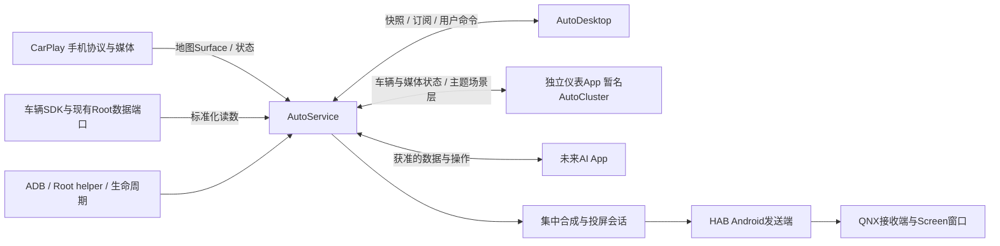

# 多应用架构规划：CarPlay / AutoService / AutoDesktop / 独立仪表

日期：2026-10-30。状态：**用户已确定产品分工方向；下列模块、协议、包名和阶段为待评审实施方案。** 本轮只研究和规划，不创建新APK、不拆改已编译的运行代码、不连接设备。

## 1. 已确定与待定

| 项目 | 状态 |
| --- | --- |
| AutoService是新独立App，位于本工程 | 用户明确确定；文中统一使用AutoService，用户输入中的AutoSevice视为同一名称 |
| AutoService负责ADB、Root、KeepAliveService、车辆基础数据与基础服务映射 | 用户明确确定 |
| 投射、地图与仪表主题等内容经AutoService集中融合和输出 | 用户明确确定 |
| AutoDesktop是独立重写的桌面程序，未来还有AI等App | 用户明确确定 |
| 完整仪表视觉不继续堆在CarPlay中，CarPlay在仪表链路中提供地图和音乐 | 用户明确方向；独立仪表App建议暂名AutoCluster，名称待定 |
| 新包名、工程是否更名、新仪表交互和最终布局 | 尚未确定；本轮不替用户定案或改现有applicationId/签名 |

CarPlay的手机连接、协议、主屏视频、通话麦克风、音频焦点和已有原车媒体能力继续由CarPlay承担。“只提供地图和音乐”是其对**仪表生态**的职责边界，不是删掉已经确认的CarPlay功能。

## 2. 应用职责

| 应用 | 负责 | 向其他应用提供/消费 |
| --- | --- | --- |
| **CarPlay** | 官方固定基线的协议/有线无线会话、音视频、电话/Siri；适配层发布地图/媒体状态并接收会话命令 | 提供111地图视频、确有来源的导航字段、曲目/封面/进度/歌词、通话状态；接受播放/切歌等命令 |
| **AutoService** | 设备能力与授权协调、ADB/Root连接、特权helper、启动/恢复；车型数据采集标准化；客户端接口；投屏会话、Surface、合成与HAB/QNX生命周期 | 对上发布统一快照/订阅；对下映射平台接口；融合各内容层并输出；唯一仪表输出owner |
| **AutoDesktop** | 桌面、应用入口、小组件、桌面地图/媒体容器、个性化；使用基础服务 | 从AutoService消费数据；发布自己的显示需求及受支持的用户命令；不各自创建Root/QNX连接 |
| **独立仪表App（暂名AutoCluster）** | 新仪表主题、布局、表盘、信息页、动画、主题配置及预览 | 从AutoService获取数据/内容描述，向其提供主题场景或独立渲染层；不直接持有HAB、QNX或车辆SDK |
| **未来AI App** | 对话、理解、助手交互等自己的产品能力 | 经AutoService消费获准数据并调用明确操作接口；不取得ADB私钥/Root shell作为通用工具 |

AutoService是运行时服务，不是几份App各自打包的一套工具库。共享SDK只封装契约和连接，设备采集与输出始终只有一个实际owner。



## 3. AutoService内部如何拆责

建议先保持一个AutoService应用模块，通过包分层，而不是一开始建立十几个空Gradle模块。公共IPC契约与客户端SDK单独成模块，便于多个App真正独立编译。

| 子域 | 责任与具体边界 |
| --- | --- |
| capability / connection | 分别报告普通App、ADB shell、ADB Root、Root helper、QNX连接能力；授权与连接状态分开，不从“安装了AutoService”推导已经获得Root |
| lifecycle | 启动协调、活跃任务、恢复预算、服务健康；车辆订阅与投屏会话按需运行，退出后释放资源 |
| vehicle | 车型/固件映射、来源目录、数据采集、单位转换、有效性/新鲜度、订阅去重和分发；先迁入已有车速/挡位/SOC等已核验来源 |
| media / navigation | 接收CarPlay等生产者的规范快照、封面引用和地图流描述；保留当前生产者与会话身份，将命令送回真正的生产者 |
| projection | 独占目标屏会话、窗口位置/层级、Surface分配、输入层与主题层合成、HAB连接、QNX接收端版本/启停与释放 |
| privileged adaptation | 执行已授权的明确设备操作；特权helper实际持有相应身份，对调用方只暴露操作结果，不透传任意shell能力 |
| diagnostics | 本地会话代次、各阶段结果、来源时效和帧计数；输出版本和脱敏诊断，不默认持久化地图帧或原始语音 |

星枢的`KeepAliveService.kt:20`明确是一次性启动协调器，`:78`完成后停止前台服务和自身；不能直接搬类名后宣称具备永久保活。其启动协调可迁入，持续订阅/投屏需按新服务生命周期实现。Android11目标固件与后续Android版本分别验收；前台服务仍有平台限制。[Android前台服务启动约束](https://developer.android.com/develop/background-work/services/fgs/restrictions-bg-start)

## 4. 数据与跨应用契约

### 小数据：明确的绑定服务与AIDL

使用显式组件绑定、版本握手、快照+订阅；不靠共享Preferences、无限广播或多个App轮询同一底层服务。Binder是IPC层，领域模型不直接依赖Android类。[Android AIDL](https://developer.android.com/develop/background-work/services/aidl)

首批契约建议：

| 契约 | 内容 |
| --- | --- |
| PlatformCapabilities | 车型/固件、已授权能力、连接状态、数据提供者、协议版本 |
| VehicleSnapshot / VehicleUpdate | 按字段携带value、unit、source、source/receipt单调时间、有效状态、到期策略、producer会话/epoch与sequence |
| MediaSnapshot | provider/session、曲名/歌手/专辑、播放状态、时长、进度基点、封面引用、歌词及其时间契约 |
| NavigationSnapshot | provider/session、实际收到的道路/转向/距离/ETA等字段、视频流描述；字段缺失不伪造 |
| ProjectionSession / LayerSpec | 目标profile、窗口viewport/z策略、输入Surface、场景版本、owner/epoch、建立/活动/释放状态 |
| UserCommand / CommandResult | 操作枚举、目标生产者、requestId、前置版本、超时及结果；接受、执行、状态确认分别表示 |

车速应区分实际车速与仪表显示车速。显示未知/失效时不填0；没有更新某字段，不因其他字段更新就把旧值变新鲜。消费者按需订阅，AutoService合并相同底层订阅；高频状态采用有界最新值分发，事件保留独立序号与明确丢失/重同步语义。

所有会话/Surface均有owner和代次；客户端死亡、服务重启、来源切换时释放旧租约，迟到回调丢弃。绑定重建后先获取全量快照再接增量，不能把旧状态当作新会话。

### 大数据：Surface与受限文件句柄

AutoService创建地图输入的BufferQueue/Surface，跨进程将生产端Surface交给CarPlay，CarPlay的111解码器仍由核心拥有并向该Surface输出；AutoService持有消费端做合成。独立仪表App可提交声明式场景或向自己获授的透明主题Surface绘制，不能与地图解码器共用同一生产端。

地图原生视频与结构化导航是两条输入，视频保留手机提供的完整内容。当前每帧RGBA约4.09MB，不经AIDL反复传Bitmap/byte[]；封面用受限URI或ParcelFileDescriptor且设尺寸/寿命。Surface支持Parcel传递，Binder事务缓存有限。[Surface](https://developer.android.com/reference/android/view/Surface)、[Binder大事务限制](https://developer.android.com/reference/android/os/TransactionTooLargeException)

这些是实施设计，不宣称当前GalaxyPlay已完成跨App Surface传输。M1先做目标固件的跨进程Surface与死亡释放验证，再迁生产链。

### 调用身份与权限映射

AutoService按Binder调用UID及登记证书核对客户端，细分数据读取、媒体发布、渲染提交和设备操作能力。App传入的包名不是身份凭据；用户确认的现有CarPlay签名不更换。签名级自定义权限适用于采用同一已确定签名策略的应用，不能通过复制applicationId获得。[Android自定义权限与UID隔离](https://developer.android.com/guide/topics/permissions/defining)

Root/ADB授权仍由明确的建立流程取得；被服务映射的是窄操作，不是给每个App复制Root身份、ADB配对材料或QNX登录信息。

## 5. 主题与合成的分工

- **主题定义归独立仪表App**：布局、字体、组件、页切换、动画及输入数据的视觉呈现规则。
- **融合机制归AutoService**：地图视频、主题渲染层、音乐和车辆快照的会话同步、最终像素合成、输出窗口及其生命周期。
- **地图语义与素材来源归CarPlay**：提供实际111流与收到的信息，不在CarPlay里绘制车速表、胎压或完整主题。
- **QNX接收进程归投屏基础设施**：作为AutoService输出路径的配套目标程序独立构建/部署，不是AutoCluster再启动第二份receiver。

一张图内部的视觉顺序和QNX窗口层级分别建模。临时阶段保留原车显示，用已核验空闲区域窗口；完整自定义主题的地图底图、仪表、音乐、来电等由主题场景定义顺序。详见[临时图层方案](仪表临时图层方案.md)与[设计还原](新仪表设计还原.md)。

AutoService负责“准备好接收端再开放投屏会话”，不能在Android发成功之前就把QNX只监听/只ACK标成已输出。QNX部署、授权连接、自有认证key和跨重启启停也列入投屏实现；本轮不假定一个Android APK天然能管理QNX进程，更不将调试Telnet口令写入产品。

## 6. 当前代码迁移表

| 当前实现 | 目标 | 迁移方式 |
| --- | --- | --- |
| `galaxy/common/.../GalaxyHabComposition.kt`、`GalaxyHabFrames.kt`、`GalaxyHabProcess.kt`、`GalaxyHabReconnect.kt` | AutoService投屏域 | 迁合成、采集/发送、恢复和资源所有权；先用现有布局验收跨App行为 |
| `galaxy/common/src/main/cpp/hab/`、`tools/hab/qnx_probe.c` | AutoService输出适配/配套QNX构建 | 复用自有源码，保留ABI/生命周期回归、独立认证和原车恢复；不能由两个App同时抢同一MMID |
| `GalaxyHabKey` | AutoService私有投屏认证 | 由新服务owner初始化并显式配置配套receiver；不让消费者App读取，不把旧调试fixture当迁移key |
| `GalaxyClusterMusicBinding`、歌词/封面处理 | CarPlay发布端 + 通用展示状态 | CarPlay继续取得真实媒体；通用快照和受限资源引用进入服务，不把Phone协议搬走 |
| `ClusterMusicView`与导航卡 | 先保留兼容主题，最终进入独立仪表App | 解除与CarPlay Activity/Preferences的布局耦合；不把完整主题复制到AutoService万能Manager |
| `CarPlayHostProduct`、`GalaxyHostAdapter`的仪表接点 | CarPlay的AutoService客户端适配 | 核心仅接收中性Surface/回调参数；不反向依赖AutoService实现或AutoCluster类型 |
| 星枢`RootAdbGateway.kt:19`及具体适配、启动协调 | AutoService能力域 | 借鉴已有端口/实现/测试；迁明确业务，不整包搬本地终端、任意脚本与重启车辆功能 |
| 星枢`VehicleChannels.kt:50`、`:100`及L6实际来源 | AutoService车辆域 | 发布已有真实来源并保留类型/单位/epoch；实际与显示车速分开，未知属性不猜 |
| 星枢`ClusterDemoRenderer.kt:142`、状态Reducer | 独立仪表App | 复用视觉与状态经验，模拟地图换为真实视频层，Demo来源不能改标签充当实时数据 |
| 原车媒体中心注册、音频焦点/PCM、电话麦克风 | CarPlay | 当前`com.ecarx.carplay`注册身份与来源6不擅自换给服务；AutoService仅分发状态并回送命令 |

新进程不自动继承原App的Binder身份/权限。迁移时逐项验证OEM回调与Root helper身份，不将“同一套代码编译通过”当作跨UID权限已通过。

## 7. 推荐工程结构

```text
GalaxyPlay/                          # 本轮保留根名，未决定是否改生态工程名
  common/                            # 现有:common，上游宿主与中性接缝
  shared/                            # 现有:shared，DiPlay固定协议核心
  galaxy/mobile/                     # 现有:mobile，CarPlay，包名和签名不变
  galaxy/common/                     # CarPlay产品适配，迁出其公共平台职责
  galaxy/shared/                     # 现有CarPlay策略，按实际归属逐步迁出
  apps/autoservice/                   # 新:autoservice，独立APK
  apps/autodesktop/                   # 新:autodesktop，独立APK
  apps/autocluster/                   # 提案，独立仪表APK，名称待定
  platform/contracts/                # :platform-contracts，AIDL与稳定DTO
  platform/client/                   # :platform-client，绑定/订阅/Surface客户端
  tools/hab/                         # 自有QNX配套构建与现场工具
```

2026-10-30已实施的目录为galaxy/service、galaxy/contracts、galaxy/client、galaxy/cluster；原提案路径以本次实现为准。CarPlay三个现有逻辑模块和唯一mobile目录继续保留。新App之间不依赖彼此implementation，也不将上游协议核心链接进AutoService。未来AI等App按同一contracts/client接入，真正出现业务边界时再拆内部平台模块。

## 8. 分阶段验收与下一步

| 阶段 | 可评审交付 | 进入下一阶段的依据 |
| --- | --- | --- |
| M0 本轮规划 | 职责/契约/迁移表、原始设计还原、图层临时方案、来源摘要 | 用户确定独立仪表App名称、整体边界和实施优先级；包名随首次骨架确定 |
| M1 服务骨架与跨App合同 | AutoService独立APK、contracts/client、身份/版本/死亡回调、跨进程Surface小样 | 多个客户端可同时读取；一方退出不破坏其他会话；Surface/服务死亡释放和恢复通过 |
| M2 投射迁入 | AutoService拥有唯一HAB/QNX会话；CarPlay111与媒体发布接入 | 原有实际地图/音乐可见；连续连接/退出/服务重启可复现；原车恢复，不出现两个输出owner |
| M3 基础能力与车辆数据 | 借鉴星枢迁ADB/Root启动与读取；统一车速、挡位、SOC、温度等首批来源 | 各来源、单位、失效/新鲜度实测，不把模拟快照交给正式消费者 |
| M4 独立仪表与临时共存 | 按原图恢复独立主题预览；经AutoService接地图/媒体/车辆输入；明确窗口区域与层级 | 原图各组件来源可追溯；实际图层与透明效果验收；不改原车内部Kanzi排序来碰运气 |
| M5 AutoDesktop | 桌面/入口/地图与音乐组件使用同一数据服务 | 不重复采集、不争用投屏/媒体/方控所有权；桌面退出不让仪表失去owner |
| M6 AI等消费者 | 逐功能接入已授权数据/操作 | 独立权限和资源预算，不靠共享Root shell接管平台 |

建议实施顺序为M1→M2，先把仪表投射从CarPlay移出并维持现有可见内容；M3数据迁入后再做M4完整主题。临时图层共存可在M2同步完成，避免等整套车速/主题做完才能使用地图和音乐。

本轮没有执行Lint、编译、安装或实车动作；只有规划文档和本地设计对照页。本轮产出不覆盖前一轮稳定性APK尚未复车的状态。协议与架构未实施前不登记为可调用API或已有独立App。
