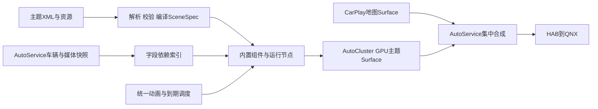

# 多投屏主题系统：源码对标与设计提案

> 后续实施更新（2026-10-30）：本文保留前一研究/优化阶段的原始证据。当前已实现可视化编辑器、17类/51预设、日夜/组件覆盖、EGL合成、可配置按内容刷新及自有GLC2消费确认；删除原100ms采集/主题轮询上限。当前源码与准确入口见[实施方案](Cluster可视化主题编辑器实施方案-20261030.md)，验证见[上车验收](Cluster上车验收-20261030.md)。实际显示帧率、8155负载与原车告警仍未实车验收。下文“当前/尚未实现”指本文初次研究阶段；四份XML草案不是现行主题包格式，可导入包由本轮运行时回归导出。

日期：2026-10-30。**本轮只研究和设计，没有实现主题引擎、修改运行代码、构建APK或连接设备。**目标仍为AutoCluster负责主题，AutoService负责数据、合成、HAB/QNX；CarPlay提供地图与音乐。文中的类型名、XML格式和动画参数均为本项目提案。

## 1. 建议方案

可以实现用户提出的“XML排组件＋内置结构与动画＋多套主题”。建议建立**声明式场景、内置组件库、统一动画时钟、GPU渲染器**四层，而不是每套主题复制一个Renderer。

XML描述位置、大小、层内顺序、样式、数据绑定和动画预设；加载时解析为不可变SceneSpec，校验后生成运行节点、资源引用、字段依赖索引和动画轨道。运行时只更新数据与视觉属性，不在每帧解析XML、读取文件或反复创建View。

XML与JSON的选择主要影响编写和工具体验；低负载来自上述运行模型、缓存和输出链优化，不能仅凭换成XML宣称更快。内置组件也可以先使用代码/内置矢量结构，再由XML配置；无需允许主题携带任意Kotlin/DEX或脚本。

## 2. 别人实际上怎样做

固定来源：AutoService **0.1.0**、AutoDisplay **3.6.2**、EVCC **2.9.46**为本地既有APK的静态解码；DiPlay-ECARX固定提交 **b46ff9be5f1674999dd910792a368bfdcd34fcf1**（[固定版本源码](https://github.com/jiopia/DiPlay-ECARX/tree/b46ff9be5f1674999dd910792a368bfdcd34fcf1)）。另查本地EVCC **3.3.3**的枚举及皮肤编辑入口，不混用两版混淆类名。物理文件行号、SHA256及解码限制见[证据索引](../tools/evidence/cluster-theme-research-20261030.json)。下文行号是本地文件实际行号，不是JADX注释中的原始行号。

前三份APK来自既有分析仓库的重签/界面分析样本，不能当作官方原始发行包或完整SDK；本轮核验其静态实现，不推断官方签名身份、全部功能可运行或目标车效果。

### 原版AutoService：数据服务与显示应用分离

原版`com.simplerbit.autoservice`和本项目`com.ecarx.autoservice`分别记载：

- [CarPropertyValue:24](../.local/decoded/AutoService-v0.1.0/jadx/sources/com/simplerbit/autoservice/contract/CarPropertyValue.java#L24)携带propertyId、valueType、status、timestampMillis、localUpdateTimestampMillis及不同类型值。
- [x5.subscribe:79](../.local/decoded/AutoService-v0.1.0/jadx/sources/defpackage/x5.java#L79)先核调用身份，再将callback按propertyId登记；[unsubscribe:100](../.local/decoded/AutoService-v0.1.0/jadx/sources/defpackage/x5.java#L100)解除登记。
- AutoDisplay的[vehicle.b:400](../.local/decoded/AutoDisplay-v3.6.2/jadx/sources/com/simplerbit/autodisplay/vehicle/b.java#L400)消费CarPropertyValue并归一化到显示状态。布局、指针与歌词绘制位于AutoDisplay，所查原版AutoService路径未见主题运行时。

**本项目借鉴**：主题绑定标准字段及其质量/时间，不自行读VHAL、Root或OEM属性。需要显示哪些字段只影响消费者分发与绘制；不缩减AutoService已确认的全量可读采集范围。

### AutoDisplay：布局、组件样式、表盘素材和动画已经拆开

实际配置链：`display_overlay_config.json → DisplayConfiguration → ScreenConfig → OverlayWidget在该屏的OverlayPlacement → tn装配 → on应用配置 → pb绘制`。

1. [OverlayPlacement:25](../.local/decoded/AutoDisplay-v3.6.2/jadx/sources/com/simplerbit/autodisplay/model/OverlayPlacement.java#L25)分别保存bounds、layer、颜色、字体、歌词行数/动画模式以及指针几何/动画参数。这里的layer是组件排序参数，不能直接当作本车QNX硬件pipeline。
2. [ym.b:110](../.local/decoded/AutoDisplay-v3.6.2/jadx/sources/defpackage/ym.java#L110)从JSON读取xOffset/yOffset/width/height、歌词与表盘样式；[ym.h:393](../.local/decoded/AutoDisplay-v3.6.2/jadx/sources/defpackage/ym.java#L393)导出formatVersion=2，screenLayout可单屏导入/导出。它用JSON，未见本需求所述XML主题格式。
3. [tn:134](../.local/decoded/AutoDisplay-v3.6.2/jadx/sources/defpackage/tn.java#L134)建立OverlayKind到组件列表的依赖；[tn.k:341](../.local/decoded/AutoDisplay-v3.6.2/jadx/sources/defpackage/tn.java#L341)按屏幕/组件配置组织实际窗口和View；[tn:741](../.local/decoded/AutoDisplay-v3.6.2/jadx/sources/defpackage/tn.java#L741)创建pb、应用组件bounds并持有on装配对象。不要将其多Window/View结构直接当成8155最低开销方案。
4. 表盘加载在[pb.getGaugeStyle:763](../.local/decoded/AutoDisplay-v3.6.2/jadx/sources/defpackage/pb.java#L763)：先查外部gauges目录，未有对应文件则查assets，结果缓存在字段F；[u9.g:169](../.local/decoded/AutoDisplay-v3.6.2/jadx/sources/defpackage/u9.java#L169)解析表盘范围、角度、盘面与指针样式。内置[theme.gauge.json](../.local/decoded/AutoDisplay-v3.6.2/jadx/resources/assets/gauges/speed/mercedes_blue/theme.gauge.json)给出0–260、起角132°、扫角276°，以及dial/needle素材和pivot。**这些参数属于样本主题，不是本车传感器范围或本项目最终样式。**
5. 指针数值动画：[pb.D:959](../.local/decoded/AutoDisplay-v3.6.2/jadx/sources/defpackage/pb.java#L959)将解析后的目标放N、当前显示放M，首次直接初始化，后续以postOnAnimation唤醒；[lb.run:45](../.local/decoded/AutoDisplay-v3.6.2/jadx/sources/defpackage/lb.java#L45)按时间差更新，限制步长并平滑追近目标，收敛后停止回调。[pb.onDraw:1791](../.local/decoded/AutoDisplay-v3.6.2/jadx/sources/defpackage/pb.java#L1791)用显示值M画表盘。这里证实的是**真实数据变化时的指针平滑**，未据此证明已有“上电扫到头再归零”。
6. 歌词动画：[pb.setText:2865](../.local/decoded/AutoDisplay-v3.6.2/jadx/sources/defpackage/pb.java#L2865)保存旧文本与切换时间；[pb.onDraw:1755](../.local/decoded/AutoDisplay-v3.6.2/jadx/sources/defpackage/pb.java#L1755)按约420ms归一化进度调用xb，未结束才继续请求动画帧；[xb.a:37](../.local/decoded/AutoDisplay-v3.6.2/jadx/sources/defpackage/xb.java#L37)处理单/多行、旧新行、位置/颜色/透明度/字号插值。JADX在一个分支中有不可信循环恢复，不能原样抄成实现。
7. [pb.onDetachedFromWindow:1663](../.local/decoded/AutoDisplay-v3.6.2/jadx/sources/defpackage/pb.java#L1663)移除本组件回调并释放其资源；服务退出也移除调度。HAB入口仍是既有VirtualDisplay/ImageReader链，与主题配置分开。

**本项目借鉴**：单个组件跨主题复用；表盘拆静态盘面和动态指针；动画保存当前值与目标值；歌词保留旧新状态；字段索引精确触发更新。全部自写源码和素材，不复制许可不明的反编译实现、盘面或字体。

### DiPlay-ECARX：复用内容与Surface生命周期，不把它称为完整主题引擎

- [EcarxClusterPresentation:35](../references/upstream/DiPlay-ECARX/common/src/main/java/com/shilapi/xcertplay/EcarxClusterPresentation.kt#L35)只承接集群视频Surface，onStop先撤回并close；[ClusterVideoTexture](../references/upstream/DiPlay-ECARX/common/src/main/java/com/shilapi/xcertplay/ClusterVideoTexture.kt)管理SurfaceTexture/Surface生命周期。
- [ClusterSpeedometerOverlay:9](../references/upstream/DiPlay-ECARX/shared/src/main/java/com/shilapi/xcertplay/airplay/ClusterSpeedometerOverlay.kt#L9)用百分比定义位置/尺寸并限制在目标画面内；这证明几何模型存在，不等于完整皮肤/指针运行时。
- [ClusterMusicView:38](../references/upstream/DiPlay-ECARX/common/src/main/java/com/shilapi/xcertplay/ClusterMusicView.kt#L38)附着时订阅，脱离解除；[onDraw:77](../references/upstream/DiPlay-ECARX/common/src/main/java/com/shilapi/xcertplay/ClusterMusicView.kt#L77)按设置位置绘制封面与标题/艺人。此固定版本的该View未见完整多行歌词时间轴与主题包系统。

**本项目借鉴**：地图内容源持续独立，换主题不重建CarPlay/HAB会话；几何、内容与资源所有权分别建模。该fork原车屏号、safeArea和签名不能移作L6参数。

### EVCC：皮肤、Dashboard、网络屏主题、Dashcast预设是不同层

EVCC确有可参考的多主题机制，但源码中的几条链不能混为同一个仪表引擎：

| 机制 | 真实做法与证据 | 能借鉴什么 |
| --- | --- | --- |
| 皮肤 | [px3:43](../.local/decoded/EVCC-v2.9.46/jadx/sources/defpackage/px3.java#L43)从evcc_skin/current.evccskin读取JSON；[px3.ll:140](../.local/decoded/EVCC-v2.9.46/jadx/sources/defpackage/px3.java#L140)校验format/schemaVersion，解析day/night/shareDayNight，保存后通知监听者与current_skin URI | 主题版本、日夜token、按组件ID覆盖、变更通知 |
| 页面布局 | [tn0.ll1:238](../.local/decoded/EVCC-v2.9.46/jadx/sources/defpackage/tn0.java#L238)保存type、spanSize、heightSpan、propertyId、gridCol/gridRow等；[DashboardGridLayout.onLayout:2854](../.local/decoded/EVCC-v2.9.46/jadx/sources/com/kooo/evcc/dashboard/DashboardGridLayout.java#L2854)摆放组件 | 布局与皮肤解耦；但其车辆控制动作不进入本项目主题 |
| 内置仪表组件 | [DashboardGridLayout:6178](../.local/decoded/EVCC-v2.9.46/jadx/sources/com/kooo/evcc/dashboard/DashboardGridLayout.java#L6178)按chart类型分支创建组件，ct1/bt1分别有弧形/码表绘制；[bt1.onDraw:230](../.local/decoded/EVCC-v2.9.46/jadx/sources/defpackage/bt1.java#L230)先画缓存静态层，再画当前值和指针 | 组件注册表、静态与动态分层 |
| 统一动画 | [au.ll:195](../.local/decoded/EVCC-v2.9.46/jadx/sources/defpackage/au.java#L195)用当前值/目标值登记轨道，替换同组件旧轨道；[y50.doFrame:26](../.local/decoded/EVCC-v2.9.46/jadx/sources/defpackage/y50.java#L26)统一Choreographer回调、插值、移除已结束轨道，仍有轨道才预约下一帧；[au.onDetached:252](../.local/decoded/EVCC-v2.9.46/jadx/sources/defpackage/au.java#L252)注销 | 一套时钟协调多组件，避免每组件一条循环/线程 |
| 静态缓存与样式覆盖 | [au.Il:88](../.local/decoded/EVCC-v2.9.46/jadx/sources/defpackage/au.java#L88)按尺寸/样式签名缓存Bitmap底层；[au.O0/OO:123](../.local/decoded/EVCC-v2.9.46/jadx/sources/defpackage/au.java#L123)优先组件样式，再用全局图表样式 | 缓存失效键包括尺寸、字体、日夜、样式；不把每帧Bitmap Canvas复制为本项目最低负载方案 |
| 网络屏多主题 | [pw2:23](../.local/decoded/EVCC-v2.9.46/jadx/sources/defpackage/pw2.java#L23)、[:57](../.local/decoded/EVCC-v2.9.46/jadx/sources/defpackage/pw2.java#L57)内置Simple Drive/Neon Stack；[nw2:8](../.local/decoded/EVCC-v2.9.46/jadx/sources/defpackage/nw2.java#L8)保存主题ID、背景、elements与landscape；[ow2:35](../.local/decoded/EVCC-v2.9.46/jadx/sources/defpackage/ow2.java#L35)创建Bitmap/Canvas，按元素类型画，ew2在NetScreenTx线程按帧率发出 | 布局是结构化元素列表；这是NetworkScreen链，不能称其已走本车HAB仪表输出 |
| Dashcast卡片预设 | [DashcastCardService:259](../.local/decoded/EVCC-v2.9.46/jadx/sources/com/kooo/evcc/dashcast/cards/DashcastCardService.java#L259)取cards_preset/activeId；[jp0:106](../.local/decoded/EVCC-v2.9.46/jadx/sources/defpackage/jp0.java#L106)在会话重启后重新应用预设。部分分支静态日志标P5 stub，不能只凭命名宣称整条显示链已验收 | 选择持久化与会话恢复分离；不证明本项目可以复用其传输协议 |

EVCC 3.3.3另外核到[ao0:21](</Users/anjon/Documents/ChatGPT/车机逆向/references/materials/artifacts/jadx/EVCC-3.3.3/sources/defpackage/ao0.java#L21>)仍有GAUGE/GAUGE_ARC；[r41:147](</Users/anjon/Documents/ChatGPT/车机逆向/references/materials/artifacts/jadx/EVCC-3.3.3/sources/defpackage/r41.java#L147>)给出Web编辑后导出.evccskin或粘贴JSON的说明。未访问其在线编辑器、商店或上传本地资料。以上不能证明存在兼容本项目的XML主题，也未在所读路径核到完整的启动扫表。

## 3. 本项目组件与主题格式

建议运行代码放`galaxy/cluster`内部包，先不新增空Gradle模块：

| 层 | 建议职责 |
| --- | --- |
| theme/ThemeCatalog、ThemeLoader、ThemeValidator | 列举主题、读取XML/资源、版本与引用核验；失败保留当前已激活场景并返回可定位错误，不将半成品切入显示 |
| scene/SceneSpec、SceneCompiler、SceneInstance | 不可变定义与可变运行态分开；坐标、样式、字段依赖预编译；主题切换原子提交 |
| component/ComponentRegistry与各组件 | 每类独立职责；解析typed props、绑定已核验字段、缓存静态结构、输出动态绘制命令 |
| animation/AnimationClock、Track、PlaybackClock | 全场景一套时钟；视觉过渡与媒体时间轴分开；可注入测试时钟 |
| render/ClusterSceneRenderer | 先接现有硬件Canvas主题Surface，后续可接RenderNode/纹理缓存；不持有Root、QNX或车辆SDK |
| preview/ThemePreview | 使用同一个编译器、组件、动画状态机和Renderer；可注入演示快照与固定时间，不另造预览画法 |

首批内置组件建议覆盖：Group/Clip、文本与图标、数字速度、指针表盘、圆弧/条形进度、四轮胎压、车辆状态行、封面、曲目信息、媒体进度与时间、多行歌词，以及地图viewport声明。可组合“大音乐＋小地图”“双表＋地图”“全地图＋紧凑媒体”等主题；具体视觉设计另按用户偏好定稿，既有布局快照不作为最终主题。

主题包可包含`manifest.xml`、`scene.xml`、`styles.xml`、图片/字体/预览图。布局、配色token、组件预设分开，可复用组件style；主题参数只读取标准数据字段。资源引用相对主题根目录，版本/缺失引用/资源预算在加载时处理，不在渲染时访问网络或执行主题脚本。

**使用自有领域XML，不直接把外部XML交给Android LayoutInflater任意创建类。**内置Android animator XML可借用其keyframe/sequence概念，但场景节点的属性由自有组件引擎更新；Android的布局XML和动画XML不是现成的跨App主题包协议。[Android属性动画/XML支持](https://developer.android.com/develop/ui/views/animations/prop-animation)

完整自写草案见[指针＋地图＋歌词主题](examples/cluster-theme-classic-v1.xml)和[地图＋紧凑媒体主题](examples/cluster-theme-map-v1.xml)。两个文件只供评审，**当前程序不加载它们，组件预设名尚未实现**。

坐标采用1920×532设计空间、明确fit/clip/anchor规则；L6/L7按已确认的相同屏幕形态处理，不按车型各写UI。主题内部z只控制自身节点/内容层顺序，不能设置原车QNX层级。输出目标profile归AutoService，不能让主题自动绑定未知displayId。

## 4. 两类动画怎样实现

### 指针表盘：启动扫表与实时平滑分别建模

- 静态层缓存盘面、刻度、数字、单位；动态层只更新指针旋转、数值与确需变化的弧线。转轴/旋转原点定义在组件局部坐标中，避免换尺寸后指针偏心。
- 实时值保留`rawValue / targetVisualValue / currentVisualValue`。新样本到来，从当前视觉值追向最新目标，替换未完成过渡，不排队播放旧车速。单位转换在绑定阶段完成，不把动画结果写回真实车辆数据。
- 启动扫表是单独的`introNeedleFraction: 0→1→0`轨道，持续时间/缓动由XML选择。它只改变装饰指针，真实数字和状态保持真实。完成后从当前状态接入最新真实值；不能无条件把正在行驶的读数强制归零。
- 首次可见、主题激活、投屏重连、车辆上电是不同事件。首版使用明确定义的“场景首次可见”事件；真实车辆上电触发须用已核验信号单列接线。绑定重建或HAB重连不重复播放启动动画。
- 新鲜的速度已非零时直接接管为真实值，扫表未完成也结束装饰轨道；数据未知/过期不伪装成0。预览模式可完整播放扫到头归零，并明确是演示。

### 多行歌词：按播放时钟切行，按动画时钟过渡

- CarPlay发布当前曲目、position基点、playing、lyrics和lyricTimes；AutoService分发，组件不重新抓手机协议或另开歌词网络请求。
- 播放位置由基点与同一单调时钟的时间差计算，暂停冻结，拖动/seek重定位。首次或seek用二分定位；正常播放到下一时间点切行，不每帧扫描整首歌词。
- 换行建立`oldIndex/newIndex/startTime/duration`，预布局可见的3/5/7行，动画只插值translationY、scale、opacity与强调色；完成后释放旧行状态，停止连续预约帧。
- 换歌、seek、停止、主题切换取消旧轨道，绑定track revision和scene epoch；跨多行跳转不逐行补播积压动画。没有时间戳的纯文本按原有来源语义呈现，不能宣称拥有逐行或逐字同步时间。

预设先做`needle-sweep`、`follow-value`、`lyrics-scroll`、`crossfade`、`slide/fade`，也允许组件声明的视觉属性组合有限keyframe轨道。新增复杂动画作为内置能力扩展，主题不携带任意执行逻辑。

## 5. 8155上的调度与缓存

1. 统一FrameClock驱动可见动画。有数据变化、活跃动画、媒体进度/歌词下一边界或数据过期deadline时才唤醒；全部静止时停连续帧回调。使用已有目标API支持的Choreographer FrameCallback，回调一次后按需重挂，不依赖API33才有的VsyncCallback。渲染owner有自己的Looper；视觉轨道起点/采样用一致的frame时间基准，媒体与数据新鲜度用一致的elapsedRealtime基准，不跨时钟直接相减；恢复唤醒后重新对齐播放状态。[官方回调语义](https://developer.android.com/reference/android/view/Choreographer#postFrameCallback(android.view.Choreographer.FrameCallback))
2. 字段依赖索引只重算受影响组件；表盘几何、文字排版、字体、封面缩放、静态资源均缓存，失效键含主题版本、分辨率、日夜模式、字体/样式。渲染热路径不做XML/JSON解析、文件/网络IO或重复创建Paint/Path/Bitmap。[Android自定义View优化](https://developer.android.com/develop/ui/views/layout/custom-views/optimizing-view)
3. **计算与缓存可以局部更新，但当前lockHardwareCanvas输出仍须完整覆盖Surface。**不能将“仅更新一个组件”写成只往未保留的buffer画一个小矩形；应重放完整场景的缓存节点和动态节点。主题缓存也不等于HAB输出只传脏矩形。
4. 地图保持独立视频层；主题只提交透明主题层和低频几何描述。当前AutoService契约只提供MAP/THEME Surface，**尚无完整场景几何协议**；支持不同地图viewport/裁剪/遮罩需新增版本化geometry描述，由AutoService编译为合成变换。保留完整地图内容，不把主题装饰矩形当作完整导航地图。
5. L6当前输出是不透明BGRA/RGBX，alpha在Android内部合成有意义，不能凭主题XML的透明区域让QNX露出原车窗口。原车显示共存/告警核验沿[前一轮记录](投屏帧优化与原车告警-20261030.md)处理，主题不能绕过它。
6. 主题切换先后台解析/准备资源，owner线程在帧边界一次替换SceneInstance；保持地图Surface与HAB owner，撤销旧scene回调，等GPU使用结束再释放资源。不能每次换皮肤重启Root/QNX或整条CarPlay会话。
7. **当前100ms采集上限仍约10fps**，420ms歌词动画最多只有约4个间隔；即使内部60Hz插值也不能让最终仪表变60fps。多主题引擎与EGL/native输出优化必须分阶段合并验收，先以动态30fps预算验证，再按源帧和目标余量推进；这是目标，未实现/未实测。

## 6. 接入与验证顺序

| 批次 | 具体交付 | 验证 |
| --- | --- | --- |
| T1 场景定义 | SceneSpec/Loader/Validator、字段适配、组件注册；把当前硬编码Renderer拆成可复用组件 | XML版本/引用/坐标/单位；现有三面板和全部有效/失效数据保持；同一快照输出一致 |
| T2 动画 | 统一时钟、扫表/实时指针、歌词滚动、seek/暂停/换歌/scene取消 | 注入时钟，检查动画中间与终点、迟到回调、非零真实速度接管、不积压轨道 |
| T3 多主题 | 两个结构不同的自有主题、日夜配色、资源与切换、同引擎预览 | 连续切换不增长线程/FD/活跃回调；地图和HAB会话不被重启，资源引用按代次释放 |
| T4 输出联调 | versioned scene geometry接入AutoService，结合EGL/native帧优化 | 原始111内容与音乐完整、viewport/旋转/裁剪正确；输入/合成/采集/发送/post耗时分段记录 |
| T5 指定车验收 | 同固件、相同内容和温度下与当前版本对照 | CPU/GPU/PSS/RSS/线程/FD、p95/p99帧间隔和延迟、丢帧、长稳/重连/停止；原车告警单独核验 |

最终主题选择、可视化拖拽编辑器、对外主题商店/云同步属于后续产品选择。本轮提供本地XML主题及内置组件架构，不将EVCC现成的商店、控制组件、脚本或网络屏协议扩大迁入项目。

## 7. 本轮检查与限制

本轮只读参考源码/反编译文本及本机资源，未运行参考APK或脚本，未访问EVCC编辑器，未上传本地材料。Android API资料只查官方站点；没有用二手报告代替本轮关键调用链。

JADX有部分方法/枚举恢复错误，AutoService还存在既有classes0.jar视图缺口；因此“所查路径未见”不等于对所有版本的绝对否定。参考代码/资源未复制进产品。XML示例仅检查良构、ID/预设/字段引用、bounds和关键帧顺序，不代表已有解析器、主题可运行或实车已支持。

本机复现命令：`python3 scripts/verify_theme_proposal.py`。2026-10-30 12:58（Asia/Shanghai）通过：两份XML、52处文档引用、29份静态源文件摘要及锚点。不进入APK，不运行Lint或设备操作；结果同时写入证据索引的verification字段。
